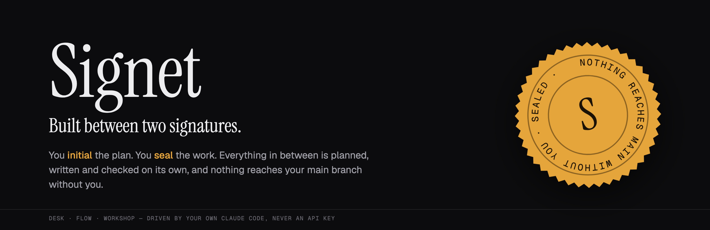
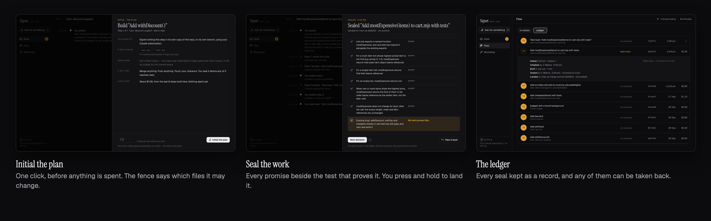
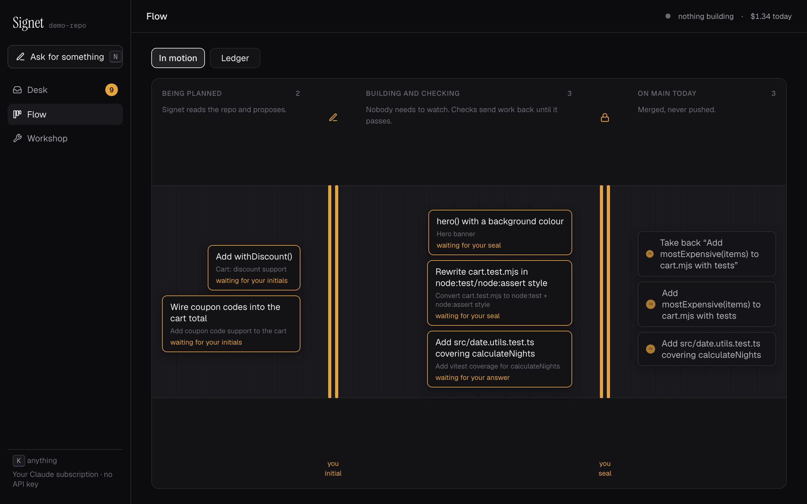
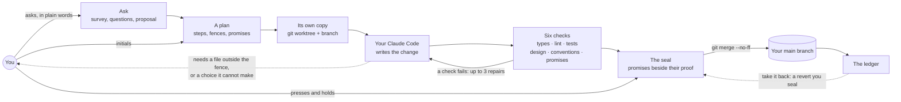

<div align="center">



<br>

**Say what you want built. Signet plans it, writes it and checks it on its own.<br>Nothing reaches your main branch until you seal it.**

<br>

[](https://www.typescriptlang.org)
[](https://nestjs.com)
[](https://react.dev)
[](https://www.prisma.io)
[](https://claude.com/claude-code)
<br>
[](#how-far-to-trust-it)
[](#the-rules-it-keeps)
[](#the-rules-it-keeps)
[](#licence)

[What it does](#what-it-does) · [The rules it keeps](#the-rules-it-keeps) · [How it works](#how-it-works) · [Run it yourself](#run-it-on-your-machine) · [The wireframes](design)

</div>

<br>

<p align="center">
  
</p>

## Why Signet

Coding agents are good at the middle of the work: reading the code, writing the change, running the tests, fixing what the tests catch. They are bad at the two ends. At the start, nobody has agreed what "done" means. At the finish, a green check is taken as proof that the work is right. The agent also tends to decide things nobody asked it to decide, quietly, somewhere along the way.

Signet does the middle on its own and keeps the two ends for you. **You initial a plan** before anything is spent: which steps, which files each may change, and what each one promises. **You seal the work** before it lands: every promise is shown beside the test that proves it. A promise with no test is shown as unproven, however green the checks are. Between the two, a step that wants to change a file outside its plan, or has to choose between two answers that would both pass, stops and asks you.

A *signet* is a seal ring. The irreversible gesture in the product is a seal you press and hold, and it leaves a stamp with the date, the time and the commit.

## What it does

| | |
|---|---|
| **Ask in plain words** | Describe the outcome. Signet surveys the repository, asks what it would otherwise have to guess (with its own answer already picked), then proposes steps. |
| **A plan you can argue with** | Each step says why it is its own step, which files it may change (drawn as a *fence*), what it promises, and anything it is still unsure of. You can drag files between fences and cut a step in two. |
| **Initial the plan** | One click, with a likely cost from the steps already built in that repo. Nothing has been spent until you initial it. |
| **Builds in its own copy** | Each step gets its own git worktree and branch. Your checkout is never touched. |
| **Six checks** | Types, lint, tests, design, conventions, and **promises**. A new test must fail on the old code and pass on the new, or it proves nothing about the change. |
| **Watch it work** | The agent's own to-do list, what it just did, and a map of the files it read and changed, with the fence drawn round what it may change. |
| **Stops to ask** | If it needs a file outside the fence, you choose: let it, make it a separate step, or stay inside. If it has to choose between answers that would both pass, it asks you instead of guessing. |
| **Seal the work** | Every promise beside its test and the lines that do it. Press and hold to land it as one merge commit. Sealing a step whose promises are not all proven is allowed, "on trust", and recorded as such. |
| **Send it back with a note** | Click a line in the change, write what you would say in a code review, and send it back for one repair. |
| **Take it back** | Any sealed change can be taken back. The revert is a new step you seal, and history is never rewritten. |
| **The Desk** | Only the decisions waiting on you. After a long absence, a morning page says what happened while you were away. |
| **Routines as sentences** | "Every night at 3:00, cover an untested module in cartographer, build the first step, then wait for my seal." A routine can start work, but it can never seal it. |

<p align="center">
  
</p>

## The rules it keeps

- **Nothing reaches main without your seal.** Only a person merges. A routine can initial a plan and start it, and then it waits.
- **Your subscription, never an API key.** Signet drives the Claude Code you already have installed and signed in.
- **It never pushes, and never moves your checkout.** It merges into your local main branch, and refuses if that repo is on another branch.
- **A fence is a hard limit.** Nothing outside a step's files is changed without you saying so.
- **Green is not proof.** Each promise needs a test that was added in the change. A promise without one is shown as unproven, and sealing it anyway is recorded.
- **Colour means you.** The console is black and white except for one amber, used only where your move is needed.

## How far to trust it

> [!IMPORTANT]
> **Signet is early.** One person uses it, on their own machine. It has taken real features end to end, from a request in plain words to a merge commit: on its demo repository, on a published npm package whose tests pass on main afterwards, and on a copy of a 262-file TypeScript service with a 570-test suite, where the change was proven by five new tests and every existing one still passed. A clean install from GitHub, on a machine with no Signet on it, has been walked through. The console was redesigned from scratch on 28 September 2026 to match [the wireframes](design). The frame-by-frame check that it matches is tracked in [`docs/wireframe-build.md`](docs/wireframe-build.md).

What it does not do yet:

- **Push.** GitHub repositories can be planned against, but not merged into, because landing work there means pushing.
- **Reach your phone.** The console has a phone layout, but Signet only listens on your own machine. How a phone should reach it (a tunnel you control, or a relay) has not been decided.
- **Run every kind of test suite.** The tests check runs JavaScript and TypeScript (the `test` script in `package.json`, with npm, pnpm or yarn), Python (pytest, when it is installed), Go and Rust. On anything else it says it cannot run the tests, and no promise can be proven by one, so each seal is your judgement. The types and lint checks are JavaScript and TypeScript only.
- **Run anywhere but macOS, so far.** Nothing is macOS-only by design, but Linux and Windows have not been tried.
- **Judge how good a test is.** The promises check proves the named test was added in this change and that the suite passed. It does not prove the test asserts the promise well. That is still yours to read at the seal.

## How it works



Everything Signet records lives in Postgres: features, steps, runs, checks, questions, and the timeline of what happened when. What the agent was given, and everything it did, is kept beside each run on disk, so "what did it know?" and "what did it touch?" always have an answer. Nothing leaves your machine except what your own Claude Code sends.

| Part | What it uses |
|---|---|
| Core | [NestJS 12](https://nestjs.com), TypeScript in strict mode. Runs, checks, the merge, and the API |
| Console | [React 19](https://react.dev) with [Vite](https://vite.dev): three places (Desk, Flow, Workshop) and one verb (Ask) |
| Contracts | Every shape that crosses a boundary is a [zod](https://zod.dev) schema first, and a TypeScript type inferred from it |
| Database | Postgres through [Prisma 7](https://www.prisma.io). For local use, an embedded Postgres on port 5765 that starts itself |
| Agent | Your own [Claude Code](https://claude.com/claude-code), run headless, one copy of the repo per step |
| Guard rails | `tooling/policy`: boundary and invariant checks that fail the build |

## Run it on your machine

You need Node.js 24.11 or newer, pnpm 11, and the `claude` command on your `PATH`, signed in. Signet uses your subscription, not an API key.

```bash
git clone https://github.com/vishalmeena2211/signet.git && cd signet
```

```bash
pnpm install
```

```bash
pnpm console
```

Then open http://127.0.0.1:4700. That one command starts the database, applies migrations, builds whatever is out of date, and serves the console and the API together. With no settings at all, the first run makes a small demo repository at `~/.signet/demo-repo` (a cart module with tests), so you can watch a feature go end to end before trusting it with a repo you care about. To use your own, pick it on the first page, where repos under `~/Desktop`, `~/code` and similar folders are listed, or type its path.

<details>
<summary>Settings</summary>

| Variable | Default | What it sets |
|---|---|---|
| `SIGNET_TARGET_REPO_PATH` | `~/.signet/demo-repo` | The repo used when a request does not name one |
| `SIGNET_DATABASE_URL` | embedded Postgres on 5765 | Where everything is recorded |
| `SIGNET_WORKSPACES_ROOT` | `~/.signet/workspaces` | One working copy per step |
| `SIGNET_PACKS_ROOT` | `~/.signet/packs` | What each run was given, and what it did |

</details>

`pnpm check` is the bar for a change: build, types, lint, the policy checks and every test. Set `SIGNET_DATABASE_URL` so the database tests run rather than skip.

## Repository layout

| Folder | What is in it |
|---|---|
| [`apps/core`](apps/core) | The core: runs, checks, merging, and the API. It also serves the console |
| [`packages/ui`](packages/ui) | The console |
| [`packages/contracts`](packages/contracts) | Every shape shared between the two |
| [`tooling/policy`](tooling/policy) | Checks that keep the layers and invariants honest |
| [`design`](design) | The wireframes: one frame for each situation you can be in, with build notes under each. Open `signet-wireframes.html` in a browser |
| [`docs`](docs) | The frame-by-frame record of building the console from those wireframes |

Versions are pinned, with the reason for each, in [`VERSIONS.md`](VERSIONS.md).

## Roadmap

- [x] Plans proposed from a survey of your repo, not typed by you
- [x] Initial and seal, with a real `git merge --no-ff`
- [x] Six checks, including tests that must fail on the old code
- [x] Each promise paired with the test that proves it
- [x] The agent stops and asks, instead of crossing a fence or guessing
- [x] Notes on lines, take it back, routines, the morning page
- [x] The console rebuilt from the wireframes
- [ ] Every frame checked against its wireframe
- [ ] Pushing, so GitHub repositories can be finished, not only planned
- [ ] Reaching Signet from a phone, safely
- [ ] Knowing which promise's proof came from a repair

## Contributing

Start with the wireframes. A change to a screen is drawn in [`design/`](design) first, with notes saying what it needs from the backend, and then built. Keep the words plain: the console talks about steps, promises and seals, not increments, gates and escalations. `pnpm check` must pass.

## Credits

Signet stands on other people's work, and names it:

- **[Claude Code](https://claude.com/claude-code)**, which does the writing, run with your own subscription.
- **Fonts:** [Geist and Geist Mono](https://vercel.com/font) by Vercel, and [Instrument Serif](https://fonts.google.com/specimen/Instrument+Serif), all under the SIL Open Font Licence and bundled through [Fontsource](https://fontsource.org).
- **Icons** drawn in the geometry of [Lucide](https://lucide.dev) (ISC licence).

## Licence

**The code is under the [MIT licence](LICENSE).** Use it, change it and share it, keeping the copyright notice.

The fonts and icons it bundles keep their own licences, named under [Credits](#credits): the SIL Open Font Licence for the fonts, and ISC for the Lucide geometry the icons follow.

## Words used here

| Word | What it means |
|---|---|
| **Step** | One piece of a feature, small enough to review on its own. It lands as one merge commit |
| **Fence** | The files a step may change. Needing anything else makes it stop and ask |
| **Promise** | One line of what a step says "done" means. Each needs a test that proves it |
| **Initial** | Your first signature: agreeing to a plan before anything is spent. One click |
| **Seal** | Your second signature: landing the work on main. Press and hold |
| **On trust** | Sealing a step whose promises are not all proven. Allowed, and recorded forever |
| **Take it back** | Undoing a sealed step, with a revert that you seal like any change |
| **Desk · Flow · Workshop** | The three places: what needs you, what is in motion, and the tuning (conventions, routines, health) |
| **Routine** | Work that starts on a schedule or an event, and then waits for your seal |

<br>

<div align="center">
<sub>Built between two signatures. Nothing reaches main without you.</sub>
</div>
